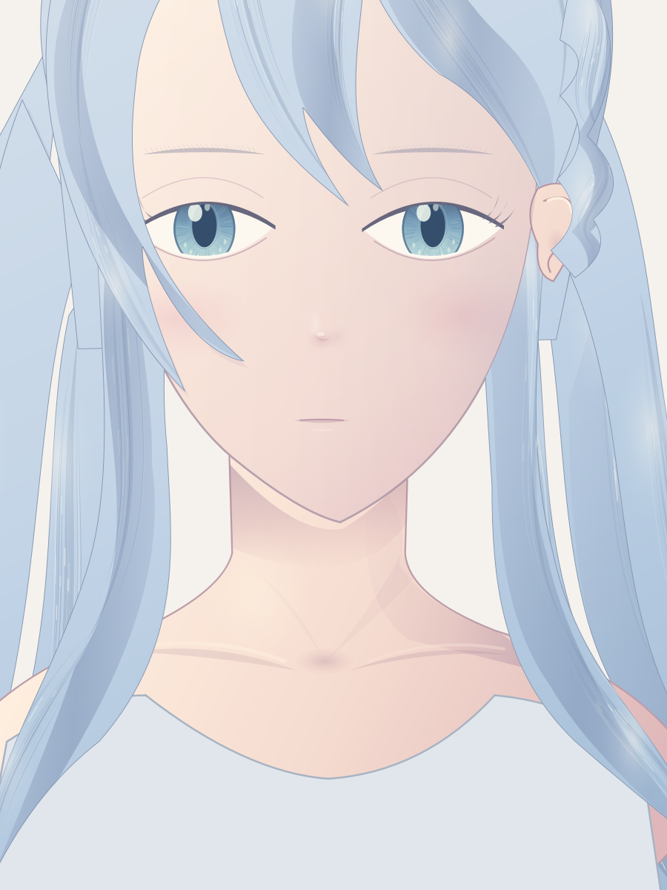

# 随包可读示例

这些文件已放进文档目录并随 Git 和知识 ZIP 分发，不依赖原机历史 `data/`。它们是自绘研究结果，不是用户原参考，也不是质量达标示例。

| 文件 | 用途与局限 |
|---|---|
| [最新整图](latest-head.png) | 当前头像与颈肩练习，头发仍带片化，衣服灰色占位 |
| [头颈原尺寸局部](head-neck-detail.png) | 看虹膜、耳部遮挡、下巴投影与颈肩转折 |
| [独立表情对照](expression-reviewed.png) | 看眉眼嘴联动；接近表情区分仍需练习 |
| [头发层级实验](hair-hierarchy-reviewed.png) | 有转折但仍像缎带/塑料，保留失败经验，不能当直接采用方案 |
| [最新完整场景](latest-head.scene.json) | 独立图层快照，不读取旧画稿；经环境适配后可创建新文档复算 |
| [本轮教程应用要素](lesson-map.json) | 方法来源、方向、主光、自检范围 |
| [来源与 SHA-256](provenance.json) | 原始出处、复制/迁移方式和文件校验 |

最新场景改了输出名，去掉了旧活动文档/空白文件名约束，绘制图层保持原样。不同 Krita/Qt 版本可能有渲染差异；当前没有在朋友机器验收。

最新分层 KRA 在交付 ZIP 的根 `artwork/latest-head.kra`。这个约 17 MB 的二进制不放入 Git；仅从 Git 获取资料时仍可查看上述 PNG 和完整场景。完整历史 KRA/原参考不随包提供。
