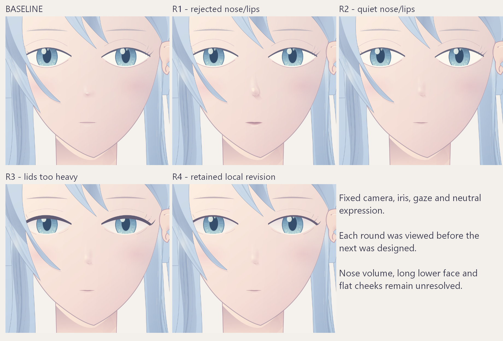

# 面部四轮练习：可直接读图的副本

来源、逐轮评估与下一步见 [本批复盘](../../head-parts/face-iterations-20261017.md)。这些是同一自绘头部的受控局部修改，不是用户原参考或四张从零设计的角色。

| 文件 | 应怎样读 |
|---|---|
| [同尺度对照板](comparison-board.png) | 从基线到 R4，R1 和 R3 含明确失败，不能默认越新越好 |
| [基线面部](baseline-face.png) | 原画稿在本批统一尺寸下的局部 |
| [R1](round1-face.png) | 鼻钩、硬亮斑和厚唇，未采用 |
| [R2](round2-face.png) | 鼻唇收敛，但鼻体积仍弱 |
| [R3](round3-face.png) | 眉/下睑/去灰部分有效，上睑过重，需返修 |
| [R4 面部](round4-face.png) / [R4 整图](round4-whole.png) | 上睑减薄，作为本批局部保留版，面部未完成 |
| [完整场景](final-scene.json) | 兼容环境下以 render 创建新文档，不需要各轮 KRA；先探索环境 |
| [前置要素](elements.json) / [文件来源与校验](provenance.json) | 控制变量、出处、复制方式和 SHA-256 |

完整场景已经在本机 Krita 新文档复算，与逐轮最终图的 ARGB32 像素完全一致；这只验证本机配方，不保证其他版本像素一致或画质通过。场景保留隐藏构造层；原生笔刷笔触为零，无下载笔刷依赖。

全量 KRA 和技术记录留在原机 `data/test-result/20261017/krita-face-iterations/`，未复制到 Git 文档目录。最新保留稿为该目录 `painting/05-round4-lid-refined.kra`。旧交接包里的 KRA 是上一批基线，不应误认为此新稿。

