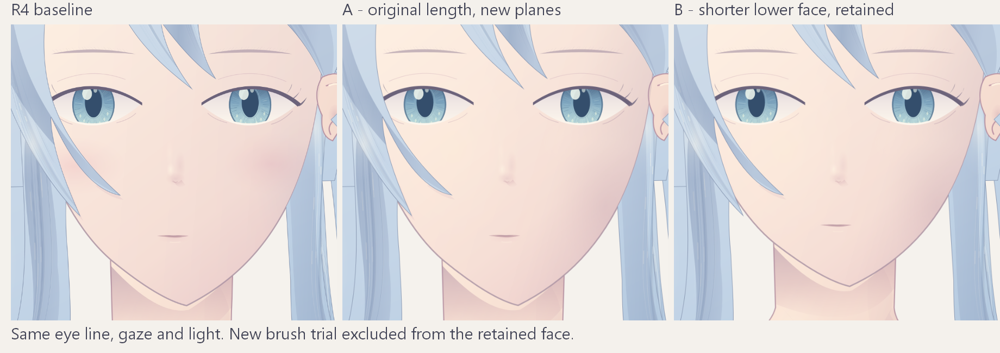

# 比例与颧颊对照：本机 MCP 实画副本

[完整学习记录](../../learning-records/face/20261017-proportions-r1.md)记录了前置方案、读图、返修和暂留原因。

- [结构草稿返修后](construction-reviewed.png)：基线/A/B，B颈肩同步；初次遗漏另在原机保留。
- [无纹理灰度大面](grey-planes.png)：先看转折，右颧亮面仍偏孤立，不视为掌握骨点。
- [整脸同尺度对照](comparison-board.png)：A保持长度、改明暗；B同时短下半脸，不能把全部变化只归因于比例。
- [暂留B面部](retained-face.png) / [整头](retained-whole.png)：颏95→86、口线62→57，颈肩上移9；画法仍偏软平。
- [未采用的罩染试验](rejected-glaze.png)：新原生笔刷叠出紫色月牙，失败图不当成画质改善。
- [完整场景](final-scene.json) / [要素](elements.json) / [来源校验](provenance.json)：保留图已去掉被否决的笔刷层，因此复算不要求安装 Deevad 包。先探索实际环境与桥接兼容性。

可编辑最终稿在原机 `data/test-result/20261017/krita-face-proportions/retained/05-B-retained-no-glaze.kra`，含隐藏的原生试验层；无全量历史KRA随文档分发。安装与笔刷小样见 [资源记录](../../resources/deevad-install-20261017.md)。

