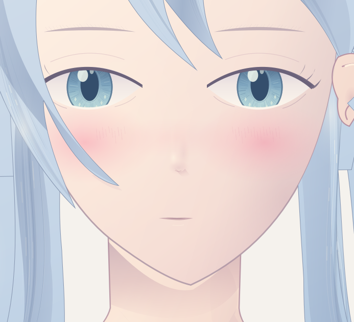
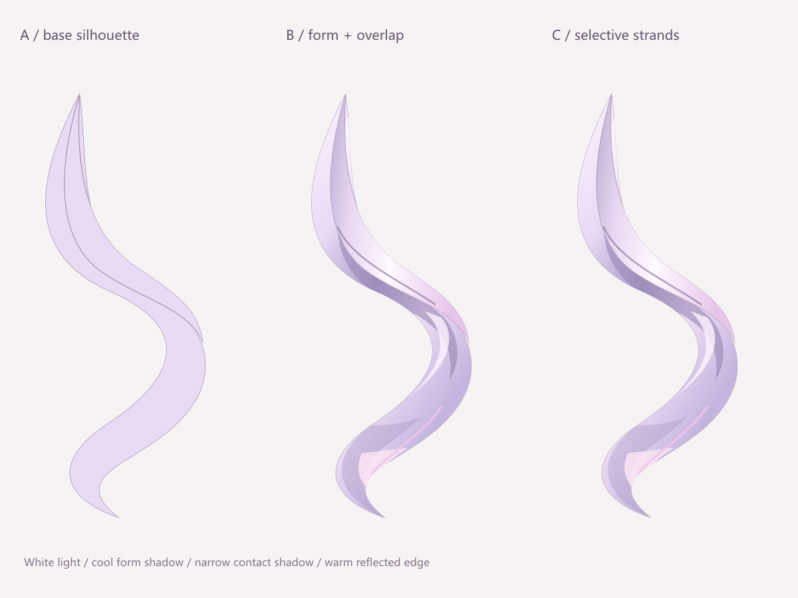

# 参考头部方法：独立局部小样

2026-10-17；[详细分析](../../head-parts/puracotte-149567189-head-analysis.md) / [各阶段读图记录](../../learning-records/face/20261017-puracotte-reference.md)。

- [腮红局部](blush-face.png)：旧 B 比例的独立新稿，加软粉色及短线；未复现参考的倾斜方向和神态。
- [发束底色/明暗/细线对照](hair-study.png)：明暗比细线更影响体积，仍有带片与硬色块问题。
- `elements.json` 为绘制前要素；`hair-scene.json` 与 `blush-scene.json` 是完整独立场景，不读取用户参考像素。原生笔刷需要已安装的 `c4) Thin Brush Regular - deevad 25.01`，先探索环境，缺失时不要谎称原样复算。
- 笔刷作者、官方下载地址与许可见 [资源记录](../../resources/deevad-install-20261017.md)。本轮确实试用了 c4，但尚未采用到旧 B 主稿。

此目录只放自绘小样。用户随后明确要求一并上传的 [原参考和观察裁剪](../../references/puracotte-149567189/README.md) 另放 references，注明第三方来源；教程图片仍不附。各阶段 KRA 和其他失败图仍在作者本机 `data/test-result/20261017/krita-puracotte-head-study/`。
