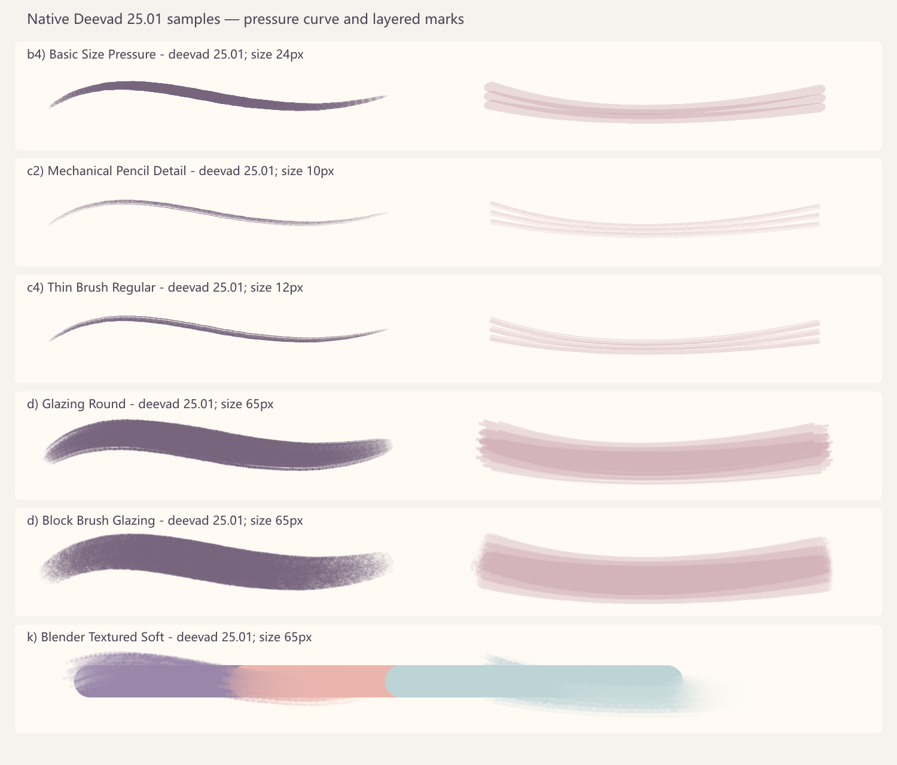

# David Revoy 25.01 导入与原生试样

2026-10-17。用户询问为什么下载却没用，并要求安装。此前优先控制造型与明暗变量，沿用已有笔刷，因而只下载核验并保留待测；并非发现不兼容。本次实际完成导入和试画。

## 来源与安装

- [作者页](https://www.davidrevoy.com/article1060/krita-brushes-2025-01-bundle)、[作者下载地址](https://www.peppercarrot.com/extras/resources/deevad-bundle_25.01.zip)，ZIP SHA-256 `4c628a9418fcde63abacafdcb143881f2cbbf907275cb4f72335545841cf8173`。
- 作者将笔刷许可为 CC0，示范作品另有许可；没有把教程图像带进本作品。作者要求 Krita 5.2.6+，本机5.3.3满足条件。
- 按 [Krita官方资源管理](https://docs.krita.org/en/reference_manual/resource_management.html)，通过设置→管理资源库→导入本地 `.bundle`，选择后按钮显示“禁用”，证明该包处于启用状态。随后 MCP inventory 返回46个带 `deevad 25.01` 的预设。
- 本机实际文件位于 `%APPDATA%/krita/Deevad_25.01.bundle`，不是猜测的 bundles 子目录；安装副本与源文件 SHA-256一致：`3ffb70e88bd9c71e436a1fa77eeea9f40b178352ca5e441424a8b00fdc2a1c43`。这是本机位置，不要求其他机器一致。
- 无需重启，无修改旧画稿。GUI导入完成后，按用户要求绘画全部返回 Krita MCP 桥接执行。

## 实际试画与观察

在独立1500×1280画布试六支笔刷，实际查看 PNG，保存同名KRA和调用清单。混色行预先铺色，避免空白上无像素可混。

| 准确预设名（均带 `- deevad 25.01` 后缀） | 参数 | 观察与当前取舍 |
|---|---|---|
| b4) Basic Size Pressure | 24px，压力采样60段 | 尖细起止可用，粗段可见采样接点，不把接口模拟当真实数位笔 |
| c2) Mechanical Pencil Detail | 10px | 较淡细纹，可作草稿候选 |
| c4) Thin Brush Regular | 12px | 有轻纹理的细线，可作局部线稿候选 |
| d) Glazing Round | 65px | 面积笔触，边缘有颗粒/接点；面部只试低不透明度独立层 |
| d) Block Brush Glazing | 65px | 软颗粒边，可能适合大面试样，尚未人物采用 |
| k) Blender Textured Soft | 65px，已有彩色条带 | 有拖混和边缘变化，不能当自动修体积；底色用 b2) Basic Size Fill Area |

右侧同路径使用30%不透明度，左侧压力曲线为全不透明度。每行尺寸不同，这不是同笔径的严格性能排名，只用于初步了解笔触。6支目标笔刷加1支铺底笔，共7个实际调用预设。

原机证据：`data/test-result/20261017/krita-deevad-install/` 下 inventory-after.json、sampler.scene.json、sampler-result.json 及 sampler/deevad-native-sampler.kra/png。作者包没有改为“已掌握”，46支也没有全部测试。面部A/B已实际试用罩染并保存开关对照；出现浓笔痕、降低图层透明度后仍无明确收益，最终保留稿关闭此层，详见 [面部比例复盘](../head-parts/face-proportions-20261017.md)。

资源二进制仍不放入 Git/知识ZIP；接收方先探索环境，按作者来源自行获取，许可与校验保存在 manifest.json。旧“下载但未使用”是历史状态，本次安装与新试验单独记录。
